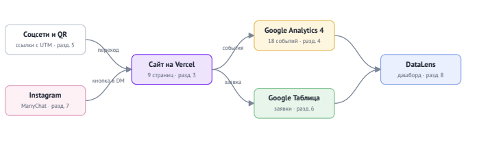

# Компьютерный клуб «РЕСПАУН» — сайт и сквозная аналитика заявок

Курсовая работа по дисциплине ОП.03 «Информационные технологии», ТЗ № ТЗ-22/2026.
Исполнитель: Кошина Александра, группа 9/2-РПО-25/3.

Сайт компьютерного клуба «РЕСПАУН» с онлайн-бронированием и калькулятором скидок: каждый посетитель приходит с меткой источника, каждая заявка попадает в Google Таблицу, а руководитель видит на дашборде, какой канал приводит клиентов.



## Ссылки

| Что | Ссылка |
|---|---|
| Сайт | https://tz-22-kompyuternyy-klub-respawn-flax.vercel.app |
| Таблица заявок | https://docs.google.com/spreadsheets/d/1KT_y3r5QNzVsVnPtUj1ashW_l2c-rtIuYQ2LIABzJzA/edit?gid=0#gid=0 |
| Дашборд DataLens | Не удалось развернуть (технические ограничения) |
| Репозиторий GitHub | https://github.com/alcelery/tz-22-kompyuternyy-klub-respawn |
| Instagram и Reel с автоответом | https://tz-22-kompyuternyy-klub-respawn-flax.vercel.app/reaction.html?utm_source=instagram&utm_medium=social&utm_campaign=respawn_nov_2026&utm_content=reel_reaction_01 |
| Telegram | https://t.me/+dTUxw0nl9ElkMTk6 |
| Описание работы | [opisanie.md](opisanie.md) |
| Презентация к защите | [zashchita.pdf](presentation/zashchita.pdf) |

Ресурс GA4: `G-FVSBR67M78`. Доступ Viewer к ресурсу GA4 выдан: `events@respawn-club.example`.

## Что сделано

| Часть | Результат |
|---|---|
| Сайт | 10 страниц (включая 404), статический HTML, Vercel, Lighthouse: есть / есть / есть |
| GA4 | 20 событий, 7 пользовательских параметров, ключевые: `generate_lead`, `contact_click`, `messenger_click` |
| UTM | 12 ссылок в реестре, публикации в 4 каналах (Instagram, Pinterest, Telegram, YouTube), QR на афише |
| Заявки | форма → Apps Script → лист `leads`, проверка полей, защита от дублей по `request_id` |
| Instagram | ManyChat, две ветки: `РЕАКЦИЯ` и `ТУРНИР` |
| Отчёты | Reports, Explore, воронка, путь, дашборд DataLens (не собран по тех. причинам) |

## Технологии

HTML, CSS, JavaScript · Google Analytics 4 · Google Таблицы и Apps Script ·
ManyChat · Yandex DataLens · GitHub и Vercel. Сайт создан с помощью **DeepSeek** и доработан вручную (запросы — в [docs/prompts.md](prompts.md)).

## Структура

```text
index.html …         страницы сайта
js/analytics.js      все события GA4
apps-script/Code.gs  приёмник заявок
docs/                описание, реестр UTM, события, записка, схема
screens/             кадры-доказательства по разделам ТЗ
presentation/        презентация к защите
Итог
Не получилось: Собрать дашборд в Yandex DataLens из-за технических ограничений доступа к сервису (ошибки загрузки интерфейса).
Нейросеть использовалась для: Генерации HTML-каркаса всех страниц, написания CSS-стилей, логики калькулятора, теста на реакцию и скрипта Apps Script для Google Таблиц.